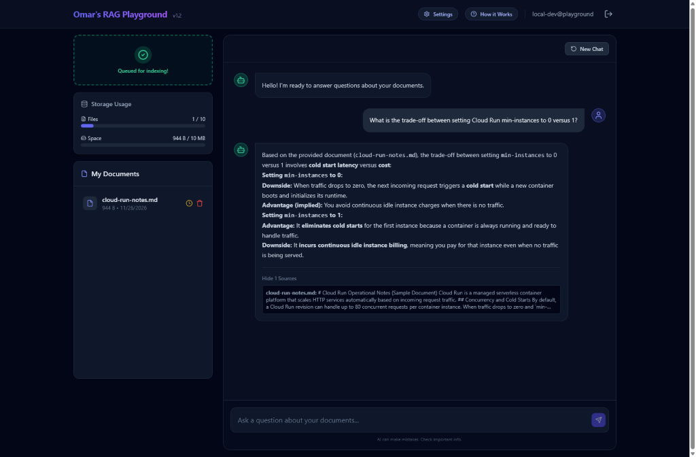
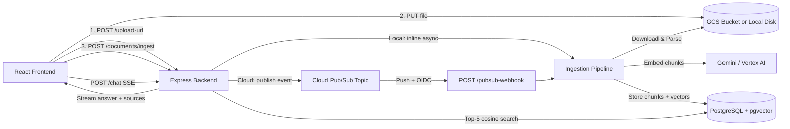

# GCP RAG Playground

A personal full-stack Retrieval-Augmented Generation (RAG) web application built with React, Node.js/Express, PostgreSQL (`pgvector`), Google Cloud Pub/Sub, and Gemini models. I built this project to practice event-driven document ingestion, vector search in PostgreSQL, and Terraform-managed GCP infrastructure.

> **Hosted Demo Status:** The live Cloud Run demo has been **shut down** to avoid ongoing Cloud SQL and idle infrastructure costs. You can run the application locally with Docker and a Gemini API key, or inspect the architecture, tests, and Terraform configuration in this repository.



Quick links: [Architecture Doc](docs/architecture.md) | [Local Setup](#local-setup) | [Cloud Deployment](#optional-cloud-deployment) | [Tests & Evaluation](#tests-and-evaluation) | [Known Limitations](#known-limitations)

---

## Verified Features

- **Document Upload & Parsing**: Supports `.pdf` (`pdf-parse`), `.docx` (`mammoth`), `.txt`, and `.md` files.
- **Configurable Chunking**: Supports `recursive` (`RecursiveCharacterTextSplitter`) and `fixed` character-window chunking with configurable `chunkSize`, `chunkOverlap`, and `minChunkSize`.
- **Asynchronous Ingestion**:
  - **Cloud mode (`INGESTION_MODE=pubsub`)**: Backend publishes an ingestion event to Google Cloud Pub/Sub (`@google-cloud/pubsub`), and a push subscription invokes `/pubsub-webhook` with OIDC token verification.
  - **Local mode (`INGESTION_MODE=inline`)**: Backend processes ingestion asynchronously in-process without requiring Cloud Pub/Sub.
- **Vector Storage & Retrieval**: Stores 768-dimensional embeddings in PostgreSQL `pgvector` with an HNSW cosine-distance index (`<=>`) and retrieves the top 5 matching chunks per query.
- **Streaming Chat & Source Citations**: Streams Gemini responses over Server-Sent Events (SSE) after emitting the retrieved `context` chunks (`filename`, `chunk_index`, `content`, similarity `score`).
- **Authentication & User Isolation**: Verifies Google Sign-In ID tokens (`google-auth-library`) and scopes storage keys (`users/<userId>/...`), document listing, chat retrieval (`WHERE documents.user_id = $2`), and deletion by authenticated user ID. (Optional `DEV_AUTH_BYPASS=true` is available only in non-production local development.)
- **Per-User Quotas & Cleanup**: Enforces 50 files and 10 MB total upload size per user; `DELETE /documents/:id` removes chunks, document metadata, and the stored file object.

---

## Architecture



### Ingestion Flow
1. The frontend requests an upload target via `POST /upload-url` (validating extension and user quota).
2. The file is uploaded directly to GCS via a v4 signed URL (cloud mode) or to `PUT /local-upload/:objectKey` (local mode).
3. The frontend calls `POST /documents/ingest`, which inserts a `pending` row in `documents` and either publishes a Pub/Sub message (`INGESTION_MODE=pubsub`) or queues in-process ingestion (`INGESTION_MODE=inline`).
4. The worker downloads the file, extracts text, chunks it, generates 768-d embeddings, and transactionally writes `document_chunks` before marking the document `completed` (or `failed` with `error_message`). Duplicate Pub/Sub deliveries for already-completed documents are acknowledged without duplicating chunks.

### Query Flow
1. `POST /chat` validates the query (`<= 2000` chars) and embeds it with `taskType: RETRIEVAL_QUERY`.
2. PostgreSQL retrieves the top 5 chunks for that `user_id` from `completed` documents ordered by cosine distance (`<=>`).
3. The backend sends an SSE `context` event containing the retrieved chunks, then streams generated tokens from Gemini.

---

## Technical Decisions & Tradeoffs

- **Cloud Pub/Sub for ingestion**: Decouples file upload from slow parsing and embedding calls so HTTP upload requests do not time out. Tradeoff: requires idempotency handling for at-least-once delivery and an OIDC-authenticated webhook endpoint.
- **PostgreSQL + `pgvector` instead of a dedicated vector DB**: Keeps document metadata, user ownership, and vector embeddings in one relational database, enabling `JOIN` filtering by `user_id` and transactional chunk replacement. Tradeoff: less specialized than dedicated vector databases at very large scale.
- **Cloud Run + Direct VPC Egress**: Scales stateless API/frontend containers to zero when idle while reaching a private-IP Cloud SQL instance without a separate VPC Access Connector. Tradeoff: cold starts when `min-instances` is 0.
- **Terraform (`infra/`)**: Defines VPC networking, Cloud SQL, Cloud Run, GCS, Artifact Registry, IAM, and Pub/Sub declaratively so environments can be torn down cleanly to stop billing.

---

## Local Setup

### Prerequisites
- Node.js 22+
- Docker & Docker Compose (for local PostgreSQL with `pgvector`)
- A **Gemini API key** (`GEMINI_API_KEY`) from Google AI Studio (requires internet access; API usage may incur charges depending on your tier/quota).

> **What runs locally vs. in the cloud:** PostgreSQL (`pgvector`), file storage (`STORAGE_MODE=local`), and async ingestion (`INGESTION_MODE=inline`) run locally. Gemini embeddings and chat generation still require an external `GEMINI_API_KEY` (or GCP Vertex AI credentials). Google Sign-In requires a `GOOGLE_CLIENT_ID`, or you can set `DEV_AUTH_BYPASS=true` in `backend/.env` (and `VITE_DEV_AUTH_BYPASS=true` in `frontend/.env`) for local testing.

### Option 1: Docker Compose (DB + Backend + Frontend)
1. Copy the example env files or export `GEMINI_API_KEY`:
   ```bash
   export GEMINI_API_KEY="your-gemini-api-key"
   export DEV_AUTH_BYPASS="true"
   ```
2. Start the stack:
   ```bash
   docker compose up --build
   ```
   - Frontend: `http://localhost:3000`
   - Backend: `http://localhost:8081`
   - PostgreSQL (`pgvector`): `localhost:5432`

### Option 2: Local DB + Node Dev Servers
```bash
# 1. Start only PostgreSQL + pgvector
docker compose up -d db

# 2. Configure and start backend
cp backend/.env.example backend/.env
# Edit backend/.env with your GEMINI_API_KEY (and GOOGLE_CLIENT_ID or DEV_AUTH_BYPASS=true)
cd backend && npm install && npm run dev

# 3. Configure and start frontend (in another terminal)
cp frontend/.env.example frontend/.env
cd frontend && npm install && npm run dev
```

Public-safe sample documents are available in [`samples/`](samples/) (`cloud-run-notes.md`, `pgvector-notes.md`, `pubsub-ingestion-notes.txt`).

---

## Optional Cloud Deployment

The [`infra/`](infra/) directory contains Terraform modules for VPC, Private Services Access, Cloud SQL (`POSTGRES_15`), GCS, Pub/Sub topic + push subscription, Artifact Registry, and Cloud Run services.

```powershell
# Set required Terraform variables (project_id, db_password, client_id) via TF_VAR_* or terraform.tfvars
./deploy.ps1
```

### Cost Considerations & Cleanup
Running Cloud SQL (`db-f1-micro` + private IP), VPC peering, Artifact Registry, and Cloud Storage incurs ongoing GCP charges even with low traffic. To tear down all provisioned resources:

```bash
cd infra
terraform destroy
```

---

## Configuration Reference

| Variable | Description | Default / Example |
| --- | --- | --- |
| `DB_HOST`, `DB_PORT`, `DB_USER`, `DB_PASSWORD`, `DB_NAME` | PostgreSQL connection settings | `localhost`, `5432`, `user`, `...`, `rag_playground` |
| `AI_PROVIDER` | `gemini` (API key) or `vertex` (GCP ADC) | `gemini` |
| `GEMINI_API_KEY` | Gemini Developer API key (when `AI_PROVIDER=gemini`) | `your-gemini-api-key` |
| `PROJECT_ID`, `REGION` | GCP project & region (required for `vertex`, `gcs`, `pubsub`) | `your-gcp-project-id`, `us-central1` |
| `EMBEDDING_MODEL`, `CHAT_MODEL` | Model IDs for embeddings (768-d) and generation | `gemini-embedding-001`, `gemini-3.8-flash` (`gemini`); `text-embedding-005`, `gemini-2.0-flash-lite-001` (`vertex`) |
| `STORAGE_MODE` | `local` (disk) or `gcs` (Cloud Storage) | `local` |
| `UPLOAD_BUCKET` | GCS bucket name (required when `STORAGE_MODE=gcs`) | `your-gcs-upload-bucket` |
| `INGESTION_MODE` | `inline` (local async) or `pubsub` (Cloud Pub/Sub) | `inline` |
| `PROCESSING_TOPIC` | Pub/Sub topic name (required when `INGESTION_MODE=pubsub`) | `your-pubsub-topic-name` |
| `GOOGLE_CLIENT_ID` | Google OAuth 2.0 Web Client ID | `your-client-id.apps.googleusercontent.com` |
| `DEV_AUTH_BYPASS` | Bypass Google OAuth in non-production local dev (`x-dev-user-id`) | `false` |

---

## Tests and Evaluation

### Unit & API Integration Tests
```bash
cd backend
npm test        # Vitest suite (config, chunking, ingestion idempotency/failures, API + user isolation)
npm run typecheck
npm run build
```

Frontend build check:
```bash
cd frontend
npm run build
```

Terraform validation:
```bash
cd infra
terraform init -backend=false && terraform validate
```

### CI Coverage
[`.github/workflows/ci.yml`](.github/workflows/ci.yml) runs backend `typecheck`, `test`, and `build`, frontend `build`, and `terraform validate` on push/PR to `main`. CI uses mocked DB/AI/Pub/Sub dependencies in unit/API tests and does **not** provision cloud infrastructure or make paid API calls.

### RAG Evaluation
A reproducible 8-case evaluation over [`samples/`](samples/) is defined in [`eval/dataset.json`](eval/dataset.json) and [`backend/src/eval.ts`](backend/src/eval.ts). See [`eval/README.md`](eval/README.md) for scoring details and limitations.

```bash
cd backend
npm run eval
```

- **Measured local run** (`gemini-embedding-001` 768-d, `gemini-3.8-flash`, `k=5`, `N=8` against local `pgvector`):
  - Retrieval Hit@5 (answerable cases): `5/5`
  - Citation Resolution: `8/8`
  - User Isolation (`eval-user-b` = 0 chunks): `PASS`
  - Manual review: all 5 answerable cases grounded in retrieved passages; both unanswerable cases explicitly reported missing context. (`N=8` is a small sanity check, not a statistical benchmark.)

---

## Known Limitations

- **Retrieval**: Fixed top-5 cosine similarity search with no hybrid keyword search or cross-encoder reranking.
- **Document parsing**: No OCR for scanned/image-only PDFs.
- **Design doc vs. implementation**: [`docs/design-doc.md`](docs/design-doc.md) was an early aspirational design (mentioning AlloyDB, side-by-side experiment comparison endpoints, and Cloud Trace) that was not implemented; the actual application uses Cloud SQL PostgreSQL, single-chat RAG with configurable chunking settings, and SSE streaming.
- **Frontend tests**: No automated frontend component tests are currently configured beyond TypeScript compilation and Vite bundling.
