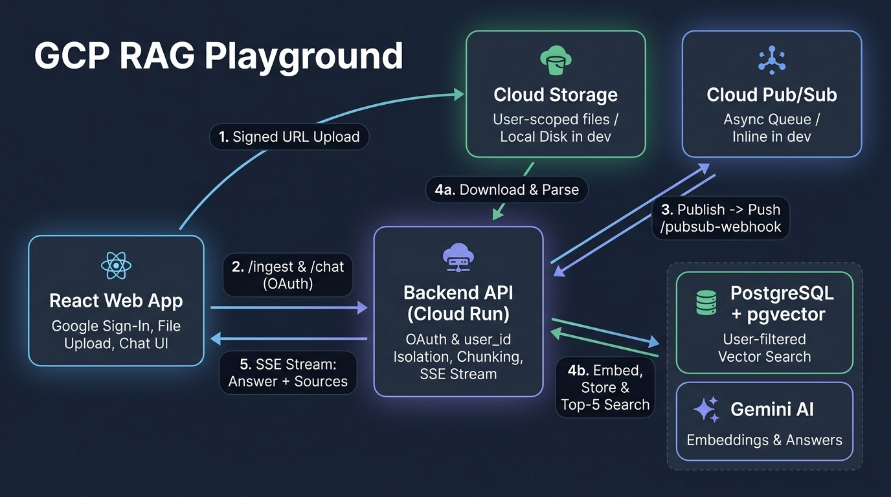
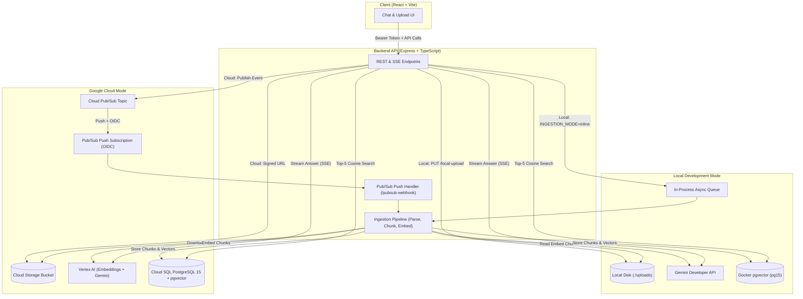
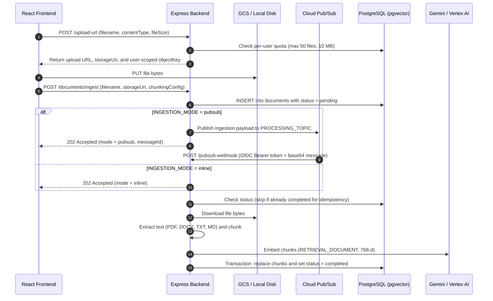
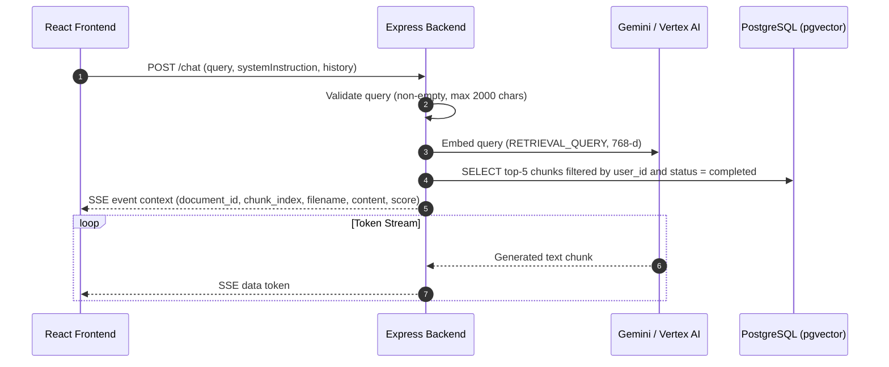
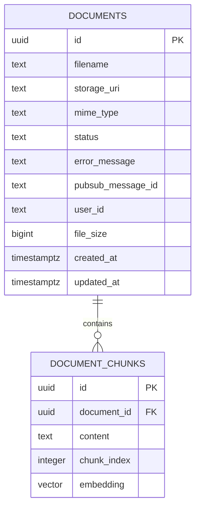

# System Architecture — GCP RAG Playground

This document describes the **implemented** architecture of the GCP RAG Playground across both its Google Cloud deployment target (`infra/`) and its local development mode (`docker-compose.yml`).

> **Historical Note:** [`docs/design-doc.md`](design-doc.md) and [`docs/GCP_Architecture.png`](GCP_Architecture.png) are early aspirational design artifacts (proposing AlloyDB, Cloud Functions, and Cloud Trace). This document reflects only what is actually implemented in the codebase and Terraform configuration.

---

## 1. High-Level Component Architecture

---

## 2. Asynchronous Ingestion Flow

Document upload is decoupled from parsing and embedding so HTTP upload requests do not time out on larger PDFs or DOCX files.

### Failure & Retry Semantics
- **Idempotency:** Cloud Pub/Sub guarantees at-least-once delivery. If `/pubsub-webhook` receives a duplicate delivery for a document already marked `completed`, it returns `200 OK` without duplicating chunks.
- **Permanent validation errors** (unsupported extension, empty/unextractable text, 0 chunks above `minChunkSize`): Recorded in `documents.status = 'failed'` with `error_message` and acknowledged with `200 OK` so Pub/Sub does not retry indefinitely.
- **Transient provider/DB errors:** Recorded in `documents.status = 'failed'` and returned as `500 Internal Server Error` so Pub/Sub retries with exponential backoff.

---

## 3. Query & Citation Flow (`POST /chat`)

---

## 4. Database Schema (`backend/db/schema.sql`)

---

## 5. Multi-Tenant Isolation Boundaries

1. **Authentication:** Requests to `/documents`, `/upload-url`, `/documents/ingest`, `/chat`, and `DELETE /documents/:id` require a verified Google Sign-In ID token (`google-auth-library`) unless `DEV_AUTH_BYPASS=true` is explicitly enabled in non-production local development.
2. **Storage Scoping:** Upload keys are generated server-side as `users/<userId>/<uuid>-<sanitizedFilename>`, preventing filename collisions and cross-user overwrites.
3. **Database Query Filtering:** All document reads, vector similarity searches (`JOIN documents ... WHERE documents.user_id = $2`), and deletes verify `user_id` at the SQL boundary.
4. **Pub/Sub Webhook Auth:** `/pubsub-webhook` verifies the Google-signed OIDC Bearer token (`PUBSUB_PUSH_SERVICE_ACCOUNT` / `PUBSUB_VERIFICATION_AUDIENCE`) in cloud mode.

---

## 6. GCP Infrastructure Topology (`infra/modules/rag-stack/`)

Terraform provisions the following resources per environment:
- **Networking:** Custom VPC, subnetwork (`10.0.0.0/20`), and Private Services Access VPC peering for Cloud SQL.
- **Cloud SQL (`POSTGRES_15`):** Private IP only (`ipv4_enabled = false`), `db-f1-micro` default tier.
- **Cloud Run v2:** Separate backend API (`${prefix}-api`) and frontend (`${prefix}-frontend`) services; backend uses Direct VPC Egress (`PRIVATE_RANGES_ONLY`) to reach Cloud SQL over its private IP without a separate Serverless VPC Access connector.
- **Storage & Messaging:** GCS bucket (`uniform_bucket_level_access = true`, CORS enabled) + Pub/Sub topic and push subscription targeting `${rag_api.uri}/pubsub-webhook` with the Cloud Run service account OIDC token.
- **IAM:** Dedicated service account (`cloud_run_sa`) granted `roles/cloudsql.client`, `roles/pubsub.publisher`, `roles/pubsub.subscriber`, `roles/storage.objectAdmin`, `roles/iam.serviceAccountTokenCreator` (for v4 signed URLs), and `roles/aiplatform.user`.

---

## 7. Key Tradeoffs & Known Limitations

| Area | Choice Made | Tradeoff / Limitation |
| --- | --- | --- |
| **Vector Store** | PostgreSQL + `pgvector` (HNSW) | Keeps relational metadata, user ownership, and vectors in one transactional DB; less specialized than dedicated vector DBs at large scale. |
| **Ingestion Queue** | Cloud Pub/Sub Push + inline local fallback | Decouples slow parsing/embedding from HTTP uploads; requires idempotent webhook handling for at-least-once delivery. |
| **Retrieval** | Top-5 cosine similarity (`<=>`) | Simple and fast, but no hybrid BM25 keyword search or cross-encoder reranking. |
| **Parsing** | `pdf-parse`, `mammoth`, UTF-8 | No OCR for scanned/image-only PDFs. |
