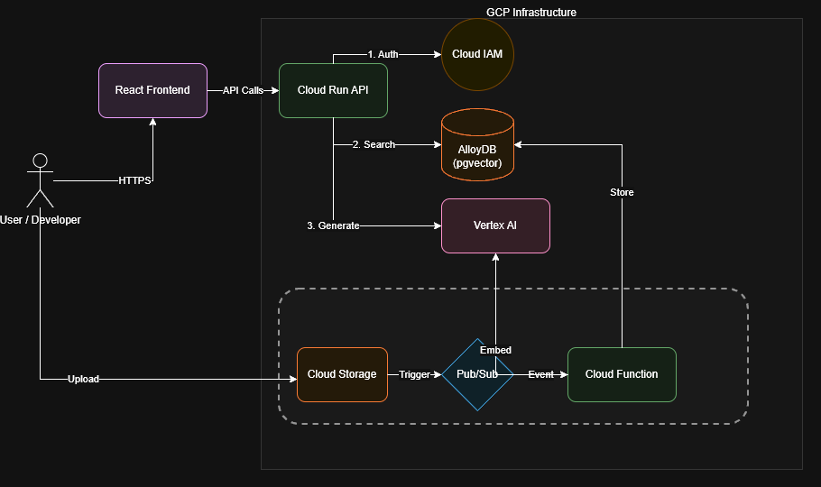
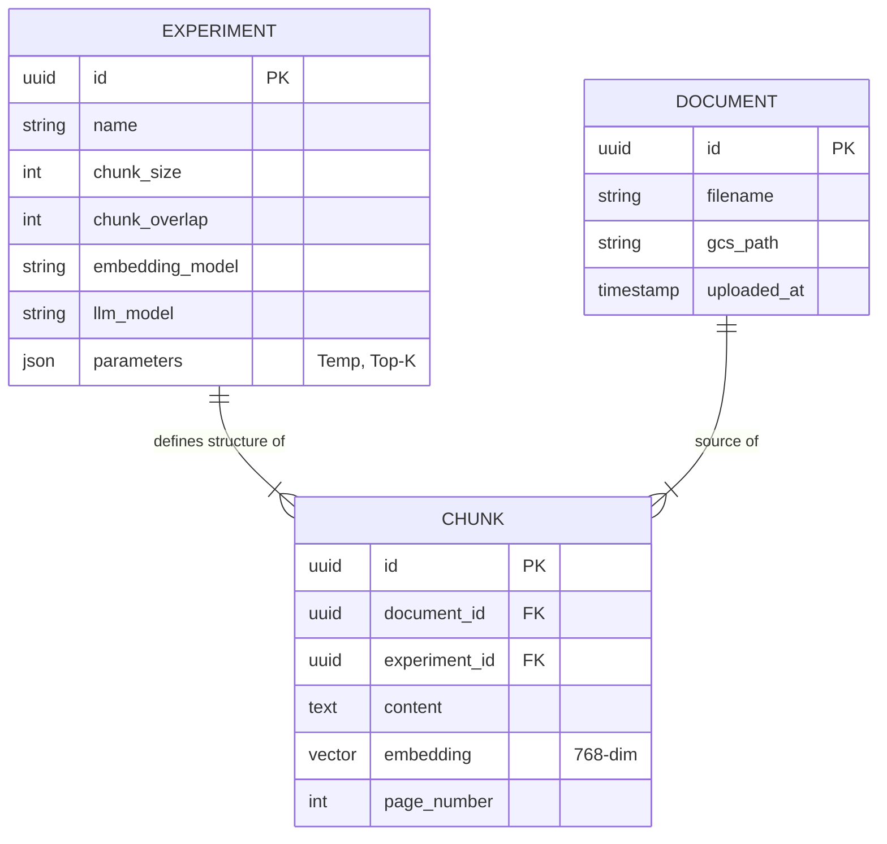

# Technical Design Document: The GCP RAG Playground

**Project:** Cloud-Native Intelligent Knowledge Assistant & Experimentation Engine
**Author:** Omar Mohamud
**Status:** Approved
**Date:** December 2025

## 1. Executive Summary

This document outlines the architecture for a scalable Retrieval-Augmented Generation (RAG) platform on Google Cloud. Unlike standard RAG implementations, this system features an Experimentation Engine that allows users to dynamically swap chunking strategies, embedding models, and LLM parameters to A/B test retrieval quality in real-time.

**Primary Goal:** To create a demonstrable, enterprise-grade AI platform that showcases expertise in System Design, Cloud Architecture, and LLM Ops.

## 2. System Architecture

The system utilizes a serverless, event-driven architecture to ensure scalability and cost-efficiency.

### 2.1 High-Level Diagram

### 2.2 Core Components

- **Ingestion Engine (Async):** A decoupled pipeline that processes raw documents. It supports "Experiment Profiles," allowing the same document to be indexed multiple times with different parameters (e.g., Chunk Size 512 vs 1024).
- **Retrieval API (Sync):** A high-performance Node.js/C# service hosting the "Playground" logic. It orchestrates the retrieval of context and generation of answers.
- **The Playground (UI):** A React-based "Lab" interface allowing Side-by-Side (SxS) comparisons of different RAG configurations.

## 3. Data Design & Schema

We use AlloyDB (PostgreSQL) for its hybrid transactional and vector capabilities.

### 3.1 ER Diagram

### 3.2 Key Decisions

- **experiment_id Partitioning:** By tagging every chunk with an `experiment_id`, we can run multiple versions of the "Brain" simultaneously without data collision.
- **Vector Extension:** We use pgvector with IVFFlat indexing for sub-millisecond similarity search.

## 4. The "Playground" Workflow

This is the standout feature for the resume. It enables A/B testing of AI logic.

**Scenario:** User wants to test if "Small Chunks" (256 tokens) work better than "Large Chunks" (1024 tokens).

1.  **Setup:** User creates two Experiments in UI: `Exp_Small` and `Exp_Large`.
2.  **Ingestion:** User uploads `manual.pdf`. The system spins up two parallel Cloud Function executions:
    - **Worker A:** Splits `manual.pdf` by 256 -> Embeds -> Saves to DB (Tag: `Exp_Small`).
    - **Worker B:** Splits `manual.pdf` by 1024 -> Embeds -> Saves to DB (Tag: `Exp_Large`).
3.  **Comparison:** In the UI, the user types "How do I reset?".
4.  **The API fires two internal queries.**
    - **Left Panel:** Shows answer from `Exp_Small` + Retrieved Context.
    - **Right Panel:** Shows answer from `Exp_Large` + Retrieved Context.

## 5. API Design (REST)

| Method   | Endpoint                | Description                                                                                  |
| :------- | :---------------------- | :------------------------------------------------------------------------------------------- |
| **POST** | `/api/experiments`      | Create a new configuration profile.                                                          |
| **POST** | `/api/documents/upload` | Upload a file and trigger ingestion for selected experiments.                                |
| **POST** | `/api/chat`             | The Core Loop. Accepts `{ query, experiment_id }`. Returns `{ answer, citations, latency }`. |
| **GET**  | `/api/eval/sxs`         | Triggers a Vertex AI AutoSxS evaluation job.                                                 |

## 6. Infrastructure & Security

### 6.1 Security

- **Private Service Connect (PSC):** The Cloud Run API communicates with AlloyDB over a private IP, never exposing the database to the public internet.
- **Service Accounts:** Granular permissions. The Ingestion Function can write to DB but not read. The API can read but not write (except for logs).

### 6.2 Observability

- **Tracing:** Every request is tagged with a `trace_id` that spans the Frontend -> API -> Database -> Vertex AI. This allows visualization of "Time to First Token" (TTFT) in Google Cloud Trace.
